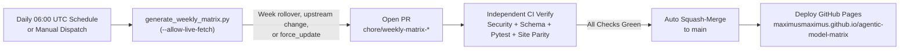

# Agentic Model Matrix

[](https://github.com/maximusmaximus/agentic-model-matrix/actions/workflows/ci.yml)
[](https://github.com/maximusmaximus/agentic-model-matrix/actions/workflows/weekly-matrix.yml)
[](https://github.com/maximusmaximus/agentic-model-matrix/actions/workflows/pages.yml)
[](https://maximusmaximus.github.io/agentic-model-matrix/)
[](#hard-policies)

CI-automated **Coding Best Practices** and **6-Stage SDLC Model Routing Matrix** designed for both **human engineering teams** and **autonomous AI agents**.

- **Live Interactive Dashboard:** https://maximusmaximus.github.io/agentic-model-matrix/
- **Agent Discovery (`llms.txt`):** https://maximusmaximus.github.io/agentic-model-matrix/llms.txt
- **Playbook & Rationale:** [`BEST_PRACTICES.md`](BEST_PRACTICES.md) · **Update Ledger:** [`CHANGELOG.md`](CHANGELOG.md)

---

## Live Matrix Status & Latest Updates

<!-- MATRIX_LIVE_STATS:START -->
> **Last Updated:** `2026-11-23T16:41:27Z` · **Week:** `2026-W48` · **Sources:** `6/6 (100%)` (avg `198 ms`) · **CI Runs:** `8` · **Hash:** `b30ad13b11b4`

| Stage | Phase | Primary Model | Effort | `agy` Mode | Fallback Chain |
| --- | --- | --- | --- | --- | --- |
| 1. `triage` | Transcript Triage & Signal Classification | `gemini-4-hydrogen-high` | `medium` | `plan` | `gemini-4-hydrogen-high` → `gemini-4-neon-medium` → `gemini-3.8-flash-high` |
| 2. `research` | Deep Research & Technical Tradeoff Synthesis | `gemini-4-neon-high` | `high` | `plan` | `gemini-4-neon-high` → `gemini-4-carbon-high` → `claude-sonnet-5-5-high` |
| 3. `consensus_specs` | Consensus Promotion & Requirements Specification | `gemini-4-neon-high` | `high` | `plan` | `gemini-4-neon-high` → `claude-sonnet-5-5-high` → `gemini-4-carbon-high` |
| 4. `architecture` | System Architecture & Edge/Storage Blueprint | `claude-opus-5-5-high` | `high` | `plan` | `claude-opus-5-5-high` → `gemini-4-carbon-high` → `gemini-4-neon-xhigh` |
| 5. `app_build` 🔒 | Full-Stack Web App Implementation (Gemini on Antigravity) | `gemini-4-neon-xhigh` | `xhigh` | `accept-edits` | `gemini-4-neon-xhigh` → `gemini-4-carbon-high` → `gemini-4-neon-high` → `gemini-4-hydrogen-high` → `gemini-4-argon-high` |
| 6. `qa_deploy` | Verification, Security Scan & Cloudflare Deployment | `gemini-4-neon-high` | `high` | `accept-edits` | `gemini-4-neon-high` → `gemini-4-hydrogen-high` → `claude-sonnet-5-5-high` |

### Latest Changes & Updates

- **`2026-11-23T16:41:27Z`** (`2026-W48`, `ci-schedule`): ISO week rolled over: 2026-W47 -> 2026-W48; Upstream update detected on `livebench-coding` (Last-Modified: Mon, 23 Nov 2026 08:28:30 GMT)
- **`2026-11-22T13:42:54Z`** (`2026-W47`, `ci-schedule`): Upstream update detected on `antigravity-docs` (Last-Modified: Sun, 22 Nov 2026 04:59:28 GMT); Upstream update detected on `antigravity-changelog` (Last-Modified: Sun, 22 Nov 2026 04:59:28 GMT)
- **`2026-11-21T13:49:37Z`** (`2026-W47`, `ci-schedule`): Upstream update detected on `antigravity-docs` (Last-Modified: Sat, 21 Nov 2026 05:31:54 GMT); Upstream update detected on `antigravity-changelog` (Last-Modified: Sat, 21 Nov 2026 05:31:54 GMT)
- **`2026-11-20T14:29:53Z`** (`2026-W47`, `ci-schedule`): Upstream update detected on `antigravity-docs` (Last-Modified: Fri, 20 Nov 2026 04:04:49 GMT); Upstream update detected on `antigravity-changelog` (Last-Modified: Fri, 20 Nov 2026 04:04:49 GMT); Upstream update detected on `livebench-coding` (Last-Modified: Thu, 19 Nov 2026 18:01:32 GMT)
- **`2026-11-19T16:09:14Z`** (`2026-W47`, `workflow_dispatch`): Upstream update detected on `livebench-coding` (Last-Modified: Tue, 17 Nov 2026 21:07:21 GMT)
<!-- MATRIX_LIVE_STATS:END -->

---

## For AI Agents & Automation

Agents should discover capabilities via [`llms.txt`](https://maximusmaximus.github.io/agentic-model-matrix/llms.txt) and consume the static JSON API directly (no authentication required; CORS-enabled via GitHub Pages).

### Machine-Readable Endpoints

| Artifact | Purpose | GitHub Pages (CORS API) | Raw GitHub (`main`) |
| --- | --- | --- | --- |
| **`routing.json`** | Authoritative 6-stage routing, effort, CLI modes & fallback chains | [pages/routing.json](https://maximusmaximus.github.io/agentic-model-matrix/routing.json) | [raw/routing.json](https://raw.githubusercontent.com/maximusmaximus/agentic-model-matrix/main/routing.json) |
| **`stats.json`** | Live source health, latencies, model distribution & Stage 5 compliance | [pages/stats.json](https://maximusmaximus.github.io/agentic-model-matrix/stats.json) | [raw/stats.json](https://raw.githubusercontent.com/maximusmaximus/agentic-model-matrix/main/stats.json) |
| **`history.json`** | Chronological CI run ledger with structured change summaries | [pages/history.json](https://maximusmaximus.github.io/agentic-model-matrix/history.json) | [raw/history.json](https://raw.githubusercontent.com/maximusmaximus/agentic-model-matrix/main/history.json) |
| **`routing.schema.json`** | JSON Schema (Draft 2020-12) validation contract | [pages/schema](https://maximusmaximus.github.io/agentic-model-matrix/schema/routing.schema.json) | [raw/schema](https://raw.githubusercontent.com/maximusmaximus/agentic-model-matrix/main/schema/routing.schema.json) |
| **`llms.txt`** | Compact agent manifest & live stage summary | [pages/llms.txt](https://maximusmaximus.github.io/agentic-model-matrix/llms.txt) | [raw/llms.txt](https://raw.githubusercontent.com/maximusmaximus/agentic-model-matrix/main/llms.txt) |
| **`BEST_PRACTICES.md`** | Full stage-by-stage engineering playbook | [pages/BEST_PRACTICES.md](https://maximusmaximus.github.io/agentic-model-matrix/BEST_PRACTICES.md) | [raw/BEST_PRACTICES.md](https://raw.githubusercontent.com/maximusmaximus/agentic-model-matrix/main/BEST_PRACTICES.md) |

### Quick Consumption Snippets

**Shell (`curl` + `jq`) — Query Stage 5 (`app_build`) routing:**

```bash
curl -sS https://maximusmaximus.github.io/agentic-model-matrix/routing.json | jq \
  '.stages[] | select(.id == "app_build") | {primary: .primary_model, fallbacks: .fallback_chain, effort, cli_mode}'
```

**Python — Load matrix and verify the Stage 5 Gemini-on-Antigravity lock:**

```python
import json, urllib.request

URL = "https://maximusmaximus.github.io/agentic-model-matrix/routing.json"
with urllib.request.urlopen(URL, timeout=10) as resp:
    matrix = json.load(resp)

app_build = next(s for s in matrix["stages"] if s["id"] == "app_build")
assert app_build["primary_provider"] == "antigravity"
assert app_build["model_family"] == "gemini"
assert all("gemini" in m.lower() for m in app_build["fallback_chain"])
```

**Git Submodule — Pin inside a downstream repository:**

```bash
git submodule add https://github.com/maximusmaximus/agentic-model-matrix.git modules/model-matrix
git submodule update --init --remote modules/model-matrix
```

### Quota Step-Down Contract (Stage 5)

When executing `app_build` via Antigravity (`agy`), iterate through `fallback_chain` in order if a Gemini tier reaches a 5-hour or weekly quota limit while preserving the same `--conversation` ID so file state and context stay intact.

---

## For Humans

### Hard Policies

1. **Stage 5 (`app_build`) Lock:** Application implementation is strictly pinned to **Gemini models running on Antigravity (`agy`)** across `primary_model` and every entry in `fallback_chain`. CI and unit tests reject any non-Gemini model in Stage 5.
2. **PR-Gated CI Activation:** Automated updates always open a Pull Request, execute full CI verification (security scan, JSON Schema check, drift check, unit tests, and Pages build parity), and squash-merge to `main` only after every check passes.
3. **Zero-Leak Public Hygiene:** [`scripts/security_scan.py`](scripts/security_scan.py) scans the entire repository (including generated `docs/` artifacts) on every push, PR, and pre-commit hook to block tokens, private keys, Tailscale/RFC1918 addresses, local paths, and personal emails.

### Repository Layout

| Path | Role |
| --- | --- |
| [`sources.yaml`](sources.yaml) | Single source of truth for stage profiles, model chains, policies, and evaluation URLs |
| [`routing.json`](routing.json) | Generated machine-readable model routing matrix |
| [`stats.json`](stats.json) / [`history.json`](history.json) | Live probe telemetry, distribution stats, and chronological CI update ledger |
| [`BEST_PRACTICES.md`](BEST_PRACTICES.md) / [`CHANGELOG.md`](CHANGELOG.md) | Generated engineering playbook and automated diff ledger |
| [`llms.txt`](llms.txt) | Agent discovery manifest |
| [`schema/routing.schema.json`](schema/routing.schema.json) | JSON Schema Draft 2020-12 contract |
| [`scripts/generate_weekly_matrix.py`](scripts/generate_weekly_matrix.py) | Generator, live source prober, diff engine, README syncer, and `--check` validator |
| [`scripts/build_site.py`](scripts/build_site.py) | Static GitHub Pages dashboard & API mirror builder (`docs/`) |
| [`scripts/security_scan.py`](scripts/security_scan.py) | Zero-leak security & PII scanner |
| [`docs/`](docs/) | Published GitHub Pages site (`index.html` + static JSON/Markdown mirrors) |

### Local Development & Verification

```bash
pip install -r requirements.txt

# Regenerate all artifacts (use --allow-live-fetch to probe live URLs)
python scripts/generate_weekly_matrix.py --root . --allow-live-fetch

# Verify schema, policy lock, artifact parity, zero-leak hygiene, and tests
python scripts/generate_weekly_matrix.py --root . --check
python scripts/security_scan.py --root .
pytest -v
```

---

## CI & Automated Publishing Pipeline



- **`.github/workflows/ci.yml`** — Runs on every push to `main` and every PR: security scan, JSON Schema validation, artifact parity check, and `pytest`.
- **`.github/workflows/weekly-matrix.yml`** — Runs daily at `06:00 UTC` (always refreshing on Monday week rollovers, whenever upstream docs/benchmarks report changes, or on manual `workflow_dispatch`): regenerates all artifacts, opens a PR with live stats & diff summary, verifies CI, squash-merges cleanly, and deploys GitHub Pages.
- **`.github/workflows/pages.yml`** — Publishes the verified `docs/` dashboard and static API to GitHub Pages on every push to `main` or manual dispatch.
